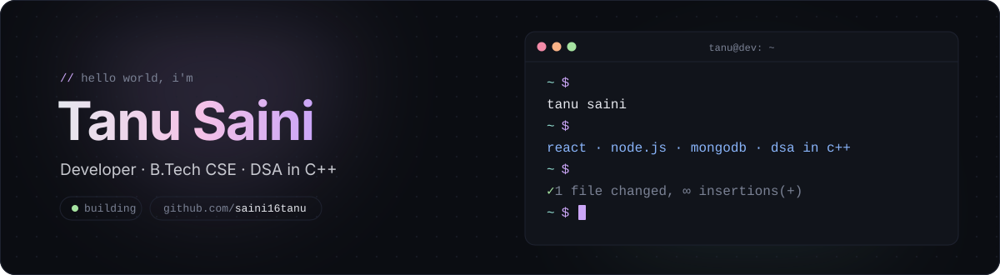

<p align="center">
  
</p>

<p align="center">
  <a href="https://linkedin.com/in/itstanusaini"></a>
  <a href="mailto:saini16tanu@gmail.com"></a>
  <a href="https://github.com/saini16tanu?tab=repositories"></a>
  
</p>

<br/>

### `$ pacman --eat commits`

<p align="center">
  <picture>
    <source media="(prefers-color-scheme: dark)" srcset="https://raw.githubusercontent.com/saini16tanu/saini16tanu/output/pacman-contribution-graph-dark.svg" />
    <source media="(prefers-color-scheme: light)" srcset="https://raw.githubusercontent.com/saini16tanu/saini16tanu/output/pacman-contribution-graph.svg" />
    
  </picture>
</p>

<br/>

### `$ whoami`

```ts
const tanu = {
  education:  "B.Tech CSE @ AKTU",
  building:   ["React apps", "MERN projects"],
  learning:   ["Node.js", "Express", "DSA in C++ (trees & recursion)"],
  openSource: "contributing through pull requests",
  askMeAbout: ["HTML", "CSS", "JavaScript", "React", "C++"],
  funFact:    "I learn best by building things and breaking them",
};
```

<br/>

### `$ cat stack.txt`

<p align="left">
  
</p>
<p align="left">
  
</p>

<sub><code>ejs</code> · <code>react-router</code> · <code>numpy</code> · <code>pandas</code> · <code>matplotlib</code> · <code>render</code> · <code>canva</code></sub>

<br/><br/>

### `$ git log --stats`

<p align="center">
  
  
</p>
<p align="center">
  
</p>

<br/>

### `$ ./contributions --3d`

<p align="center">
  
</p>

<br/>

### `$ ./mochi --eat commits`

<p align="center">
  
</p>

<br/>

<p align="center"><sub><code>// thanks for stopping by — let's build something together</code></sub></p>
